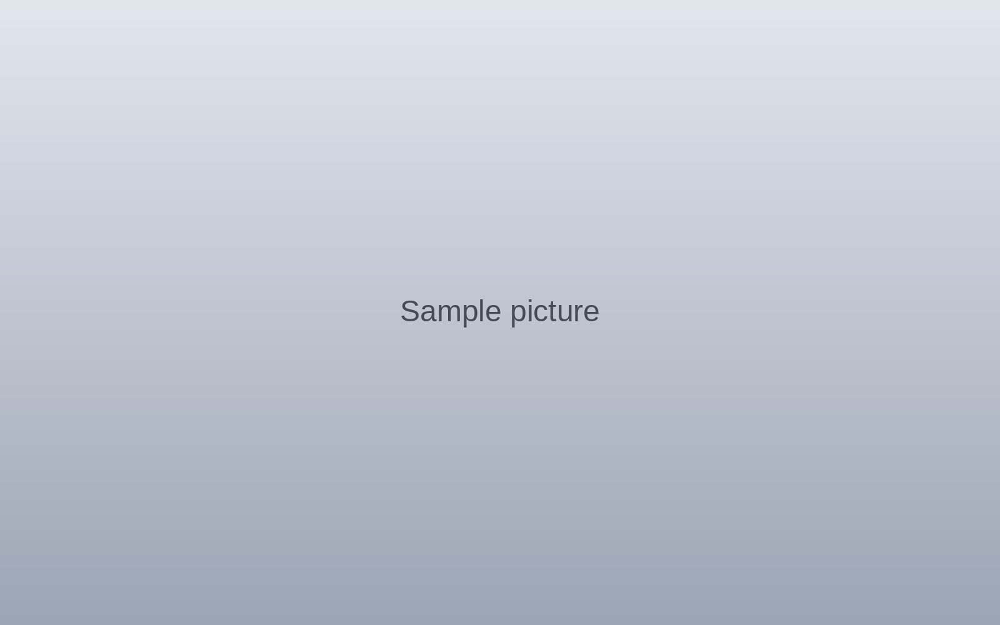

This is the first post on the new site. Every paragraph you write is justified across the narrow column, in black Helvetica, with nothing else on the page to distract the reader. To start a new paragraph, leave one empty line.

## A subheading

Subheadings are centred automatically. Put two hash marks and a space in front of a line to make one. To make a word stand out in blue, put one star on each side of it, like *this*. Two stars on each side make it blue and bold, like **this**. A link is written like this: [Wikipedia](https://www.wikipedia.org).

This line is a caption under the picture.
{: .caption}

> A quotation is written with a greater-than sign at the start of the line.

- A list item starts with a dash and a space.
- Here is a second item.

You can delete this post when you publish your own first post.
